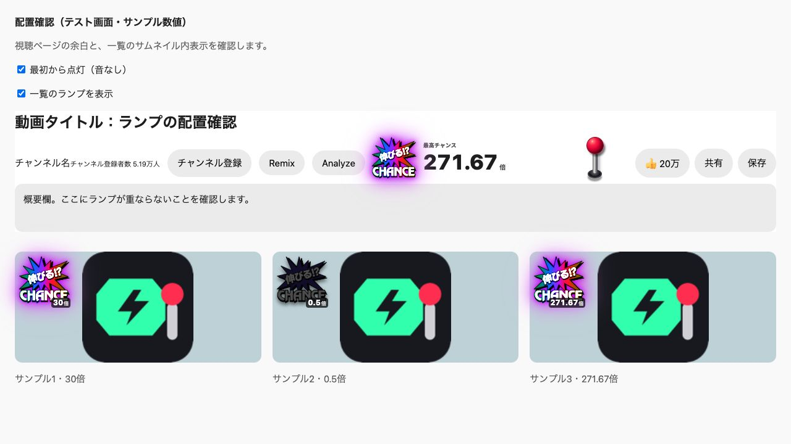

# YouTube 伸びる!? CHANCE — チャンスランプ

YouTube動画の **再生数 ÷ チャンネル登録者数** を調べ、レバーを引くとランプが点灯するChrome拡張です。ランプは、ギザギザの中を「伸びる!?」、下を「CHANCE」にした透過画像です。4色とも濃い色と強い発光を使い、虹の点灯中は虹色が流れ続けます。「動きを控えめにする」をオンにすると虹の動きは静止します。

| 色 | 初期判定 | 告知音 |
|---|---|---|
| 消灯 | 1倍以下 | 短い下降音 |
| 緑 | 1倍超〜3倍未満 | 二段キュイン |
| 赤 | 3倍以上〜10倍未満 | Max bet |
| 金 | 10倍以上〜30倍未満 | reba |
| 虹 | 30倍以上 | ガコッ |

## ダウンロード

[最新版の配布ZIPをダウンロード](https://github.com/meguta12/youtube-chance-lamp/releases/latest/download/youtube-chance-lamp.zip)

## Chromeに入れる

1. 配布ZIPをダウンロードして展開します。
2. Chromeのアドレス欄に `chrome://extensions` を入力して開きます。
3. 右上の **デベロッパー モード** をオンにします。
4. **パッケージ化されていない拡張機能を読み込む** をクリックします。
5. 展開した **youtube-chance-lamp フォルダ** を選びます。`icons` フォルダやZIPファイルは選びません。
6. 開いているYouTubeのタブを再読み込みします。

ZIPから使う場合は、先にZIPを展開してください。更新後は拡張カードの再読み込みボタンとYouTubeのタブの再読み込みが必要です。

## 使い方

- **視聴ページ**：Analyzeなどのチャンネル側ボタンと高評価の間に、ロゴ・倍率・レバーを表示します。タイトル下から概要欄上までの空き高さを使い、ボタンに重ならない大きさへ調整します。横の余白が足りない場合は同じ情報帯の中へ移ります。
- **検索結果・ホーム・関連動画**：サムネイル左上に小さなランプだけを重ねます。レバーや大きな枠は表示せず、カードの高さを変えません。ランプをクリックするとその動画を判定します。
- **音と設定**：Chromeツールバーの拡張アイコンをクリックします。色別の音、音量、ミュート、表示、倍率の境界を変更できます。
- **自動点灯**：設定の「最初からランプを点灯（音なし）」をオンにすると、画面に見える動画から自動判定します。表示されるだけでは音は鳴りません。オフならレバーまたはランプをクリックして判定します。
- **キーボード**：Tabでレバー・ランプへ移動し、EnterまたはSpaceで操作できます。

`www.youtube.com` の通常動画が対象です。YouTube Studio、モバイル版、Shortsの縦型プレーヤーは対象に含めていません。登録者数が非公開・0人、公開情報を読めない動画は点灯せず理由を表示します。

## 先に光と音を試す

このフォルダの **デモを開く.command** をダブルクリックすると、Chromeで体験画面が開きます。各色を選んでレバーを引いてください。拡張に使うものと同じ光と告知音です。デモの数値はサンプルです。

同梱音源の由来は [THIRD_PARTY.md](THIRD_PARTY.md) に記載しています。

体験画面の設定はデモ専用に保存します。拡張の設定はChromeツールバーの拡張アイコンから保存してください。

## 判定の出典と取得方法

[YouTube分析ツール](https://github.com/meguta12/youtube-research-tool) の `subscriberRatio = viewCount / subscriberCount` と、`subscriberRatio > 1` の判定を使用しています。[参照した計算式](https://github.com/meguta12/youtube-research-tool/blob/2448e61a4515b81c9fa9a638995ee6aa7bb61a38/src/lib/youtube.ts#L297-L302)

元ツールの「伸びチャンス」は「運営12か月未満＋検索ヒット動画の平均再生数10,000超」という別の指標です。この拡張の4色は倍率による分類で、その別指標や相対ヒートスコアは使いません。

視聴ページでは公開DOMを読みます。動画カードはランプをクリックしたとき、または自動点灯がオンで画面内へ表示されたときに、YouTubeの公開動画ページ・必要に応じてチャンネルページを取得します。動画ID・チャンネルIDの一致を確かめ、データを混ぜません。表示上の登録者数は丸められているため倍率は **概算** です。将来の再生数や成功確率を予測するものではありません。

- APIキー・ログイン操作は不要。既存分析ツールの保存データやAPIキーにはアクセスしません。
- 権限は設定保存の `storage` と `https://www.youtube.com/*` だけです。
- 取得した数値はブラウザ内で処理。YouTube以外のサーバーへ送信しません。
- 公開情報の取得は最大3件同時、メモリー上の15分キャッシュで同じ動画の連続取得を抑えます。Chromeの拡張用サービスワーカーが終了するとキャッシュも消えます。
- 告知音は拡張に同梱した音源をWeb Audioで再生します。レバー音は合成音です。音量0・ミュート・動きを控えめにする設定があります。音源読込に失敗すると理由を表示します。停止・ミュート・別の動画への移動後に、遅れて届いた音が鳴ることはありません。音源を再生するときの音量だけを調整し、元ファイルはそのまま同梱しています。

## 読み取れないとき

ページを再読み込みして再度レバーを引いてください。登録者数非公開、年齢・地域等の制限、同意ページへの移動、YouTube側の構造変更、通信タイムアウトは取得できない場合があります。誤った数値を補って点灯することはありません。

小型ランプは最大180枚まで配置します。一覧が多い場合は動画を開いて視聴ページのランプを使ってください。表示された倍率はレバーを引いた時点またはキャッシュ取得時の値です。

## 動作確認

55件のロジックテストと8項目の静的検査、ブラウザ上の配置試験を実施しています。実際のYouTube上での最新版の最終確認は未実施です。



## 開発・検証

ビルド不要のManifest V3拡張です。

```sh
node --test tests/*.test.cjs
node tests/static-check.cjs
```

`core.js` = 計算・安全なJSON解析、`background.js` = 公開データ取得、`content.js` = YouTubeへの配置、`chance-ui.js` = Shadow DOMのランプ、`effects.js` = 同梱音源の読込・再生とレバー合成音、`assets` = 透過ランプ画像、`sounds` = 4色の告知音、`popup.html/js/css` = 設定と体験、`icons` = 16/32/48/128pxアイコン。

画面に入った動画の判定とサイズ変更の検知には、[IntersectionObserver](https://developer.mozilla.org/en-US/docs/Web/API/IntersectionObserver/IntersectionObserver) と [ResizeObserver](https://developer.mozilla.org/en-US/docs/Web/API/ResizeObserver) を使っています。

Chrome APIの構成は [content scripts](https://developer.chrome.com/docs/extensions/develop/concepts/content-scripts)、[storage](https://developer.chrome.com/docs/extensions/reference/api/storage)、[message passing](https://developer.chrome.com/docs/extensions/develop/concepts/messaging) の公式資料を確認しています。

## ライセンス

ソースコードは [MIT](LICENSE)。同梱の外部音源は別の扱いです。[素材の表記](THIRD_PARTY.md)を参照してください。
